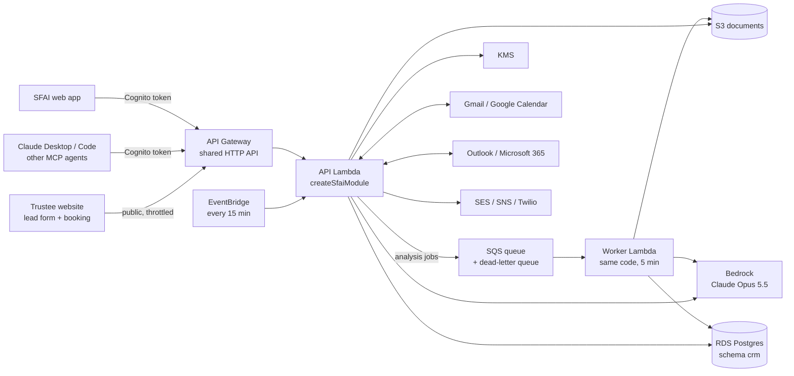

# SFAI Platform Module

Backend for SFAI on AWS: the CRM (clients, intake, statutory deadlines, scheduling,
reports, automations, integrations, **Ask your CRM**), plus the document platform that
replaced FileSecure's Supabase Edge Functions: **AI document analysis**, search, tasks,
notifications, e-signatures and client-portal invitations. AI runs on Amazon Bedrock.

It is a **module, not an app**. It plugs into the bigger SFAI project and reuses its
login, database, API and deployment, so nothing is paid for twice.

```
sfai-platform-module/
  api/     the backend module (TypeScript, Hono, Drizzle, Postgres)
  infra/   AWS CDK: the SfaiModule construct + an example host stack
```

## Run it locally (no AWS, no Docker)

```bash
npm install
npm run dev -w api        # http://localhost:3000/api  (demo firm, demo data)
npm test                  # 47 end-to-end tests against a real in-process Postgres
```

The dev server uses PGlite (Postgres in WebAssembly, data in `api/.data`), a stand-in
for Cognito (demo login **trustee@demo.test / demo-password**, or `x-dev-firm` headers),
files in `api/.data/files` instead of S3, and logs emails/texts instead of sending them.

```bash
curl -H "x-dev-firm: demo-firm" http://localhost:3000/api/clients
```

## Drop it into any Node API

```ts
import { createSfaiModule, toNodeHandler } from "@sfai/platform-api";

const crm = await createSfaiModule({
  db,                       // optional: the host's Drizzle Postgres connection
  authenticate,             // optional: the host's login (default: shared Cognito pool)
});

// AWS Lambda behind API Gateway
export const handler = crm.lambda;

// Express (also Fastify via middie, or node:http)
app.use(toNodeHandler(crm));
```

`authenticate(request)` returns `{ id, firmId, role }` or `null`. Every query is scoped
to `firmId`, so one database serves many trustee firms.

The module's tables live in their own Postgres schema (`crm`), including its migration
history, so they never clash with the host project's tables.

## Architecture



One Lambda serves the API. A second Lambda (same code) runs background jobs from SQS:
document analysis can take a minute, longer than API Gateway's 30-second limit.
Inside the API, every request goes through the same steps:

1. **Login**: API Gateway checks the Cognito token, then `authenticate()` checks it
   again and reads the user's firm and role. Portal clients (role `client`) are
   refused on every staff route.
2. **Route**: `src/routes/*` validate the input (Zod) and call the domain code.
3. **Domain**: `src/domain/*` holds the business rules: deadlines, automations,
   sending email, firm setup.
4. **Integrations**: `src/integrations/*` talk to Gmail, Outlook, SES, SNS, Twilio and S3.
5. **Audit**: every successful change is written to `crm.audit_log`.

| Folder | What lives there |
|---|---|
| `src/index.ts` | `createSfaiModule()`: wires login, routes, CORS, errors, audit |
| `src/routes/` | HTTP endpoints, one file per area |
| `src/domain/` | Business rules (deadlines, automations, email, firm setup) |
| `src/integrations/` | External services (OAuth, email, mail sync, calendar, SMS, S3, OSB) |
| `src/ai/` | Bedrock client, the CRM tools + agent, document analysis |
| `src/jobs/` | The 15-minute scheduled job, the SQS job queue |
| `src/db/` | Tables, migrations, connections, demo seed |

## How email works

**Sending** (compose screen, automations, approved AI drafts) always goes through
`emailClient()` in `src/domain/email.ts`:

1. Pick the channel: **Gmail** if the firm connected Google, else **Outlook** if it
   connected Microsoft, else **Amazon SES**.
2. Send. With Gmail/Outlook the email comes from the trustee's own address, so the
   client's reply goes to the trustee's inbox.
3. Store a copy in `crm.emails` (direction `out`) and add "Email sent" to the timeline.

**Receiving** (client replies, new client emails): `pullMail()` in
`src/integrations/mailsync.ts` runs every 15 minutes (or on `POST /messages/email/sync`):

1. Read new messages from Gmail / Outlook (headers + a short preview only).
2. Keep only messages to or from a known client's address. Everything else is ignored.
3. Store them in `crm.emails` and add "Email received" to the client's timeline.

**Replying**: `POST /messages/email` with `replyToId` sends a "Re:" in the same Gmail
thread or Outlook conversation.

To connect a mailbox, the trustee clicks **Connect Google** or **Connect Microsoft**,
which calls `GET /integrations/:provider/connect` and signs in. Firms on SES only can
send, but replies go to the SES sender address, not into the CRM.

## Connect AI agents with MCP

The CRM is an MCP server at `POST /api/mcp` (Streamable HTTP, stateless). It exposes the
same tools as Ask your CRM: `search_clients`, `get_client`, `list_deadlines`,
`practice_overview`, `draft_email`. It uses the same login, and only shows the caller's firm.

**Claude Code:**

```bash
claude mcp add --transport http sfai-crm https://API_URL/api/mcp \
  --header "Authorization: Bearer $COGNITO_ID_TOKEN"
```

**Any MCP client:** point it at `https://API_URL/api/mcp` with the same
`Authorization: Bearer` header.

`draft_email` is marked as not read-only, so MCP clients ask before running it. Even
then it only creates a draft; a person still approves it under `/drafts`.

Cognito ID tokens last an hour. Claude.ai's custom connectors need an OAuth 2.1 server
with dynamic client registration, which Cognito doesn't provide yet. That is the next
step if you want the connector to stay signed in.

## How the agent works

`src/ai/agent.ts`, "Ask your CRM":

1. The user's question and earlier turns go to Claude (Bedrock) with the CRM tools.
2. Claude picks tools, for example "find clients in Assessment" or "list deadlines in 7 days".
3. The SDK's tool runner runs them here, scoped to the user's firm, and returns the
   results. Claude repeats this (up to 10 rounds) until it can answer.
4. Writing tasks end as **drafts**. Nothing reaches a client without a person's approval.

The tools are defined once in `src/ai/tools.ts` and shared by the in-app assistant and
MCP. To add a capability, add one tool there and both get it.

Automations (`src/domain/automations.ts`) are the deterministic side: fixed rules
("documents missing 3 days -> reminder") that run on a schedule without AI.

## API

All routes are under `/api` and need a signed-in user unless marked public.

| Route | What it does |
|---|---|
| `GET/POST /clients`, `GET/PATCH /clients/:id` | List, intake, profile, update (moving to **Filed** creates the statutory deadlines) |
| `POST /clients/:id/docs` | Tick documents on the checklist |
| `GET /clients/:id/sin` | Reveal a SIN (trustees only, always audited) |
| `GET/POST /deadlines`, `POST /deadlines/:id/done` | What's due, internal tasks |
| `GET/POST/DELETE /appointments` | Schedule (pushes to the connected calendar) |
| `GET/POST /activities` | Timeline |
| `POST /documents/upload-url`, `.../:id/complete`, `.../:id/download-url` | S3 uploads via short-lived links; completing an upload queues the AI analysis |
| `GET /documents`, `GET/PATCH /documents/:id` | List (all or `?clientId=`), one document with its analysis + signatures, rename / folder / client / who must sign |
| `GET /documents/search?q=` | Full-text search over names and what the AI read |
| `POST /documents/:id/analyze` | Re-run the AI analysis (202, runs in the background) |
| `POST /documents/:id/signatures` | Sign as the logged-in user; the document is **signed** once every required party has |
| `GET/POST /tasks`, `PATCH /tasks/:id` | To-dos; the AI adds one per medium/high risk it finds |
| `GET/POST/DELETE /notifications`, `POST /notifications/read` | My notifications; notify a colleague (in-app links only) |
| `POST /ai/chat`, `POST /ai/financials` | Trustee assistant chat; monthly budget check |
| `GET/POST /portal/invites`, `DELETE /portal/invites/:id` | Client-portal invitations (trustees) |
| `POST /messages/email` | Email one or more clients; `replyToId` answers inside a thread |
| `GET /messages/email/:clientId`, `POST /messages/email/sync` | A client's email conversation; pull new mail now |
| `POST /messages/sms` | Text a client |
| `GET /drafts`, `PATCH /drafts/:id`, `POST /drafts/:id/send`, `DELETE /drafts/:id` | AI-written emails waiting for a person to approve |
| `GET /reports/summary` | KPIs, leads by month, sources, stages, file types |
| `GET/PATCH /settings`, `/settings/templates`, `/settings/automations` | Firm settings, email templates, automation switches |
| `GET /integrations`, `GET /integrations/:provider/connect`, `POST /integrations/twilio`, `POST /integrations/calendar/sync`, `GET /integrations/osb/export` | Integrations |
| `POST /assistant` | Ask your CRM. Returns `{ text, draftIds }` |
| `POST /mcp` | The CRM as an MCP server (Streamable HTTP) |
| **Public:** `GET /public/embed.js`, `POST /public/:key/leads` | Website lead form |
| **Public:** `GET /public/:key/slots?date=`, `POST /public/:key/bookings` | Online booking page |
| **Public:** `GET /integrations/:provider/callback` | OAuth return (verified by a signed state) |
| **Public:** `POST /public/portal/activate` | A client sets their password from the invite link (creates a Cognito login, role `client`) |

## The FileSecure web app's backend (replaces Supabase)

The web app (`src/` at the repo root) used to talk to Supabase directly. It now uses a
look-alike client (`src/lib/sfai/`) with the same calls (`supabase.from(...).select()`,
`supabase.auth...`, `supabase.storage...`), backed by this module:

| Was (Supabase) | Now (AWS) |
|---|---|
| Auth (email + password) | Cognito, the shared user pool. Trustees sign up a new firm; clients get a login from their invite link |
| Postgres tables + row-level security | `POST /data/:table`: the app's 70+ tables as firm-scoped JSON rows in `crm.records`, with the access rules in `api/src/data/policies.ts` |
| Storage buckets | `POST /files/*`: S3 under `<firm>/<bucket>/<path>`, 5-minute links |
| Realtime | Polling `POST /data/:table/changes` every 5 seconds |
| Database functions (portal invites) | `POST /rpc/*` and `POST /public/portal/*` |

**How a query runs:** the app's chain (`from("documents").select("*").eq("user_id", id)`)
becomes one JSON request. `src/data/access.ts` adds the firm and the table's rule, and
`src/data/query.ts` turns the filters into SQL with every value bound as a parameter.

**The table rules** (`src/data/policies.ts`), on top of "only your firm":

| Rule | Tables |
|---|---|
| Anyone at the firm (default) | documents, estates, clients, tasks, creditors, claims... |
| Only your own rows | notifications, user_settings, user_preferences, api_integrations, conversations; profiles (everyone reads, you edit yours) |
| Read + add only | audit and access logs |
| Trustees only write | client_portal_invitations, client_portal_access |
| Server only | user_roles |
| Always the signer | signatures |
| Portal clients | only the portal tables and their own estate(s), as the old RLS did |

**Why one JSON table:** the old app writes many free-form columns (metadata objects,
per-estate schedules). Keeping each row as JSON means no 70 hand-written table
definitions to drift out of sync, and new columns need no migration. The trade-off: no
foreign keys or joins in the database. As pages move to purpose-built routes, their
tables can move to typed tables like the CRM's.

| Route | What it does |
|---|---|
| `POST /data/:table` | `{ action: select | insert | update | upsert | delete, filters, or, order, limit, values, onConflict... }` |
| `POST /data/:table/changes` | Rows changed since a time (live updates) |
| `POST /data/documents/:id/analyze` | AI analysis of one of the app's documents (writes `document_analysis`, `tasks`, `notifications`) |
| `POST /files/upload-url`, `/download-url`, `/list`, `/remove` | File storage |
| `POST /rpc/redeem_client_portal_invitation`, `/rpc/record_client_portal_login` | Portal, after the client signs in |
| **Public:** `POST /public/signup` | A trustee creates a new firm and login |
| **Public:** `POST /public/portal/peek`, `/opened`, `/activate` | Invite links: preview, mark opened, set password |
| **Public:** `GET /public/files/view?bucket&path&token` | Checks the login token, redirects to a 5-minute S3 link (for `` / `<iframe>`) |

## Where the old Supabase Edge Functions went

The FileSecure app called 17 Supabase Edge Functions. They now live here, behind the
same login and firm checks as everything else (the old ones trusted ids sent by the
browser and could read or change any user's data). `src/lib/sfaiFunctions.ts` in the
app maps each old name to its new route, keeping the same `{ data, error }` result.

| Old function | Now | AWS service |
|---|---|---|
| process-ai-request, analyze-document, deepseek-document-analysis, enhanced-document-analysis, enhanced-osb-analysis, analyze-document-metadata, analyze-financial-ocr | One pipeline: `POST /documents/:id/analyze` (and automatically after upload) | S3 → SQS → worker Lambda → Bedrock (Claude reads PDFs and scans directly, no OCR service) |
| ai-task-generator | Tasks created during analysis; `GET /tasks` | Postgres |
| smart-search | `GET /documents/search` | Postgres full-text search (no AI call, no Exa) |
| deepseek-chat | `POST /ai/chat` | Bedrock |
| analyze-financial-data | `POST /ai/financials` | Lambda (plain arithmetic) |
| handle-notifications | `/notifications` | Postgres |
| process-document | `/documents/:id`, `/documents/:id/signatures` | Postgres |
| process-client-intake | `POST /clients` | Postgres |
| handle-integration | `/integrations` (real Google / Microsoft / Twilio connections) | Secrets Manager + KMS |
| create-client-portal-account | `/portal/invites` + `POST /public/portal/activate` | Cognito + SES |
| setup-storage | The CDK creates the private, encrypted documents bucket | S3 |

DeepSeek, Exa, Tesseract and the OpenAI test calls are gone: one AI provider (Bedrock),
billed on the same AWS account.

## Integrations

| Integration | How it connects | Set up |
|---|---|---|
| Website lead form | Paste the embed code from `GET /integrations` | Add the website to `websiteOrigins` (CORS) |
| Online booking page | Public slots + bookings API, using the firm's hours | Set hours in `PATCH /settings` |
| Google Calendar + Gmail | OAuth; two-way calendar + email sync, send as the trustee | Google Cloud OAuth client, redirect `…/api/integrations/google/callback`. Reading Gmail is a *restricted* scope: Google must verify the app (security assessment) before outside users can connect |
| Outlook + Microsoft 365 mail | OAuth (Microsoft Graph); two-way calendar + email sync | Entra app registration (Mail.ReadWrite, Mail.Send, Calendars.ReadWrite), redirect `…/api/integrations/microsoft/callback` |
| Email fallback | Amazon SES | Verify the sending domain in SES (ca-central-1) and leave the SES sandbox |
| SMS | Twilio (if connected) or Amazon SNS | Twilio credentials via `POST /integrations/twilio` |
| OSB filing | CSV export of filed estates | The OSB has no public filing API |

Put Google/Microsoft client IDs and secrets in the **CRM secret** in Secrets Manager
(stack output `CrmSecretArn`) as `GOOGLE_CLIENT_ID`, `GOOGLE_CLIENT_SECRET`,
`MS_CLIENT_ID`, `MS_CLIENT_SECRET`, `MS_TENANT`.

Automations run every 15 minutes (EventBridge Scheduler): welcome email + call-back task for new
leads, booking confirmations, missing-document reminders, deadline reminders (email +
SMS) and "no contact in 14 days" alerts. Each runs at most once per client and occurrence.

## Ask your CRM (Bedrock)

Claude Opus 5.5 (`anthropic.claude-opus-5-5`) through the Bedrock Messages endpoint,
signed with the Lambda's IAM role. The same client powers chat and document analysis.

**Document analysis** sends the file itself (PDF, image or text) to Claude, which returns a
fixed, validated JSON shape: form type and key fields (`extracted_info`), `risks`,
`recommendations`, a suggested folder and financial figures. It runs at `low` effort
(extraction) and can use its own model: set `ANALYSIS_MODEL_ID` (CDK: `analysisModelId`)
if you want a cheaper model for this high-volume work. Files over 20 MB, Word and Excel
are stored but not analyzed; save them as PDF to analyze them. It uses tools to search clients, read a client's file,
list deadlines and summarise the practice. It can **draft** emails but never sends them;
a person approves each draft under `/drafts`. If Claude declines a request, the SDK retries once on
`anthropic.claude-opus-4-8`.

Before first use: enable both models in the Bedrock console (Model access) in ca-central-1.

**Data residency:** ca-central-1 serves Claude through Global or US routing only, so
assistant prompts are processed outside Canada. Client data, documents and backups stay in
ca-central-1. Set `BEDROCK_MODEL_ID` to a US inference profile if you need US-only routing.

## Deploy to AWS

```bash
cd infra
npx cdk bootstrap aws://ACCOUNT/ca-central-1      # once per account
npx cdk deploy -c appUrl=https://app.sfai.ca -c emailFrom=crm@sfai.ca \
  -c websiteOrigins='["https://www.yourfirm.ca"]'
```

`infra/lib/shared-platform.ts` is an **example host stack**. In the bigger project, keep
its VPC/database/Cognito/API and add one line:

```ts
new SfaiModule(this, "Crm", { vpc, database, userPool, userPoolClient, httpApi, appUrl, emailFrom });
```

Database migrations run automatically after each deploy.

Users need two Cognito attributes: `custom:firm_id` and `custom:role` (`trustee`,
`staff` or `client`). Sign-up and portal activation set them; staff added to an
existing firm are created by an admin. Users can't change them, so the host pool's app
client must not let users write custom attributes.

The web app needs `VITE_SFAI_API_URL`, `VITE_COGNITO_USER_POOL_ID` and
`VITE_COGNITO_CLIENT_ID` (stack outputs), and the module's `appUrl` must be the web
app's address (CORS).

## Backups and security

- **Database:** automated daily backups with point-in-time restore for 14 days. Plus a
  monthly snapshot kept for 1 year (AWS Backup), and a final snapshot if the stack is
  deleted. Deletion protection is on.
- **Documents:** S3 versioning (deleted or overwritten files are recoverable for 90 days).
- **Encryption:** KMS for the database, documents, SINs and OAuth tokens. A SIN can only
  be decrypted with its own firm's ID, and every reveal is written to the audit log.
- Every change (who, what, which record) is written to `crm.audit_log`.
- Public routes are throttled by API Gateway and the lead form has a bot trap.
  (AWS WAF doesn't support HTTP APIs; put CloudFront + WAF in front if you need it.)

## Rough monthly cost (ca-central-1, one firm)

| Item | Approx. |
|---|---|
| RDS PostgreSQL db.t4g.micro + 20 GB | ~$18–22 |
| NAT instance (t4g.nano) | ~$3–4 |
| KMS key + Secrets Manager (2 secrets) | ~$2 |
| Lambda (API + worker), API Gateway, SQS, S3, SES, Scheduler, Cognito | ~$0–5 at small-firm traffic (mostly free tier) |
| Bedrock (Ask your CRM, chat, document analysis) | pay per use: tokens per page analyzed and per question |

## Before going live

- Have your compliance lead confirm the deadline rules in `api/src/domain/rules.ts`.
- Verify the SES domain and request SES production access.
- Enable the Bedrock models.
- Sign-up is public (throttled by API Gateway) and creates a firm with no email check.
  Add email verification (Cognito) or invite-only staff accounts before opening it up.
- `getPublicUrl` links carry the user's login token in the URL (it expires within an
  hour); the bucket itself is never public.
- Document analysis runs in the background (SQS), so it has no 30-second limit. Watch
  the dead-letter queue (`JobsDlq`): a message there is a document that failed 3 times.
- Long assistant questions must finish within API Gateway's 30-second limit. If they
  don't, move `/assistant` to a Lambda Function URL with response streaming.
- Mailboxes connected before email sync was added must reconnect once to grant the
  read scope.
